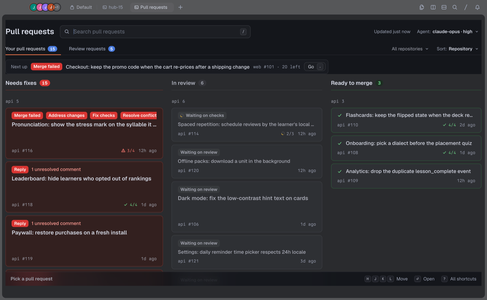
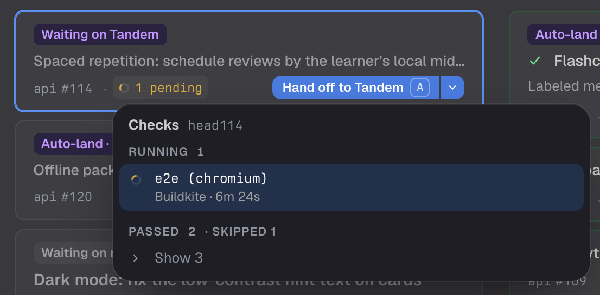
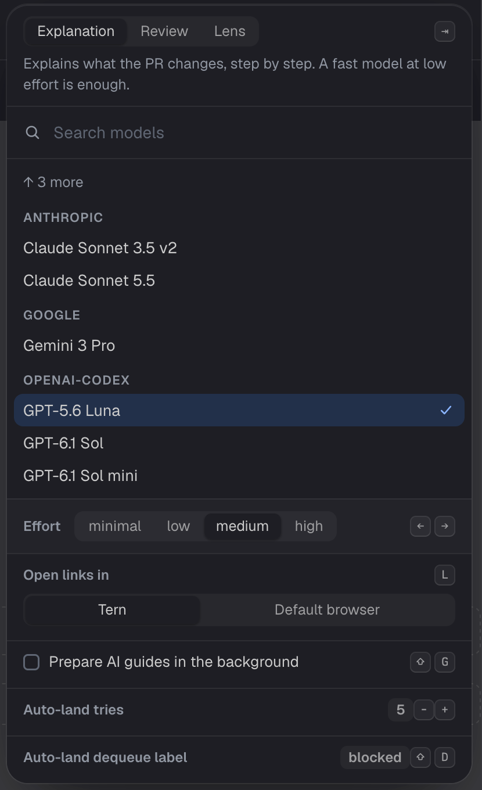
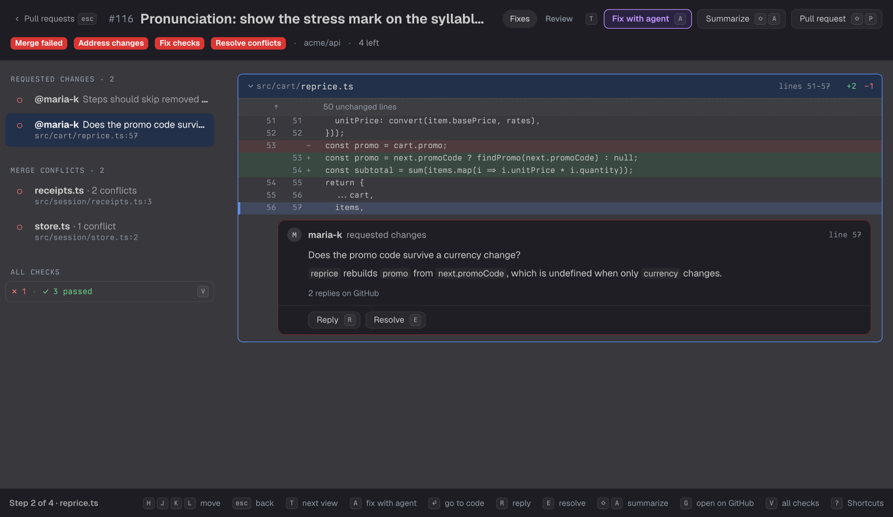
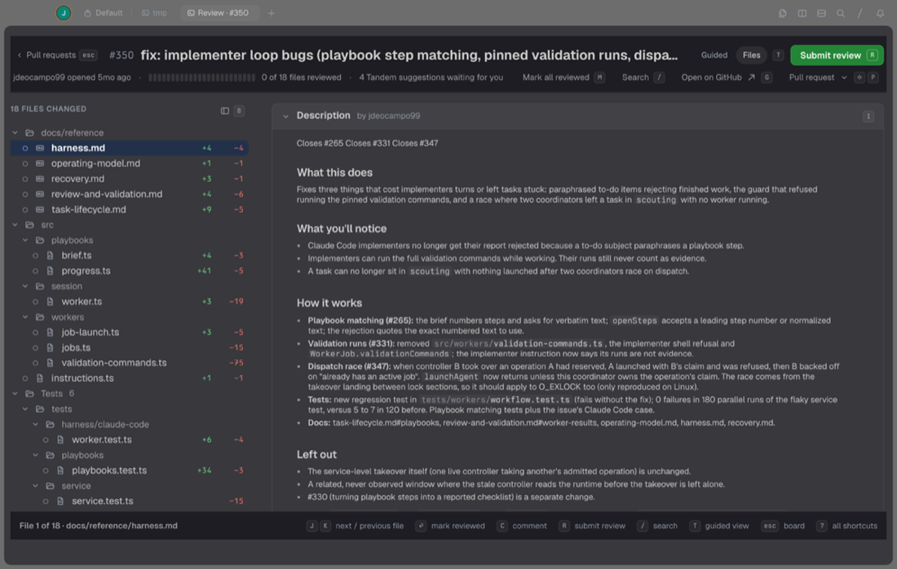
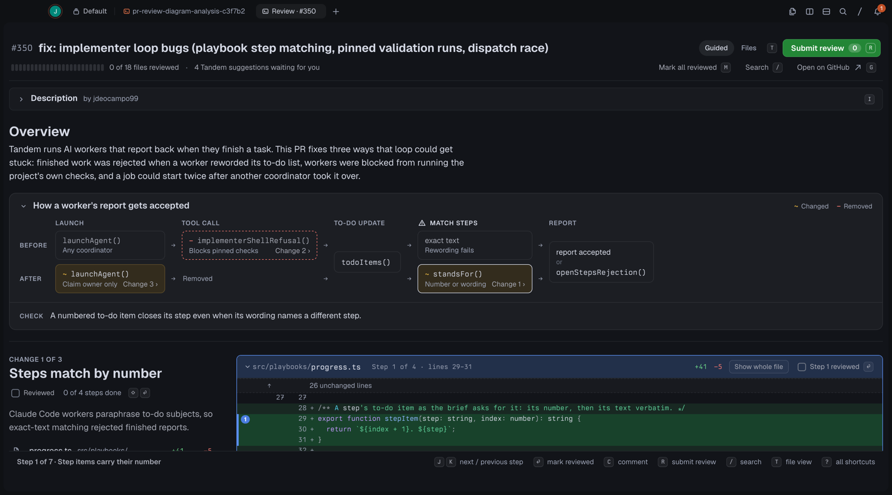
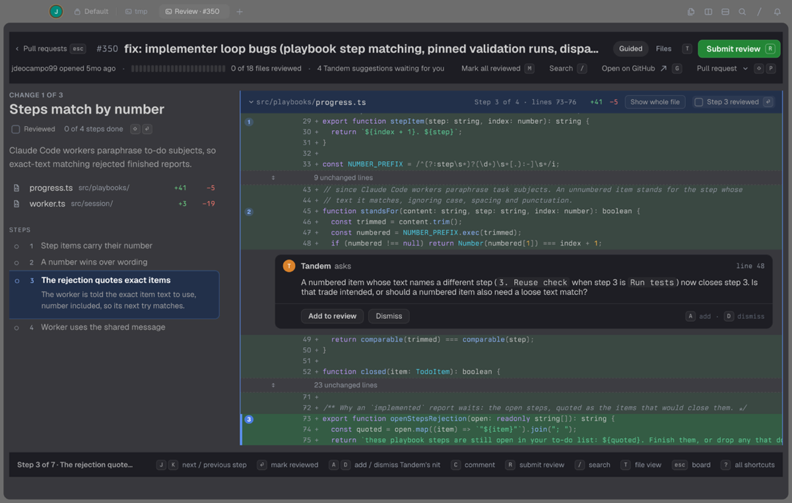
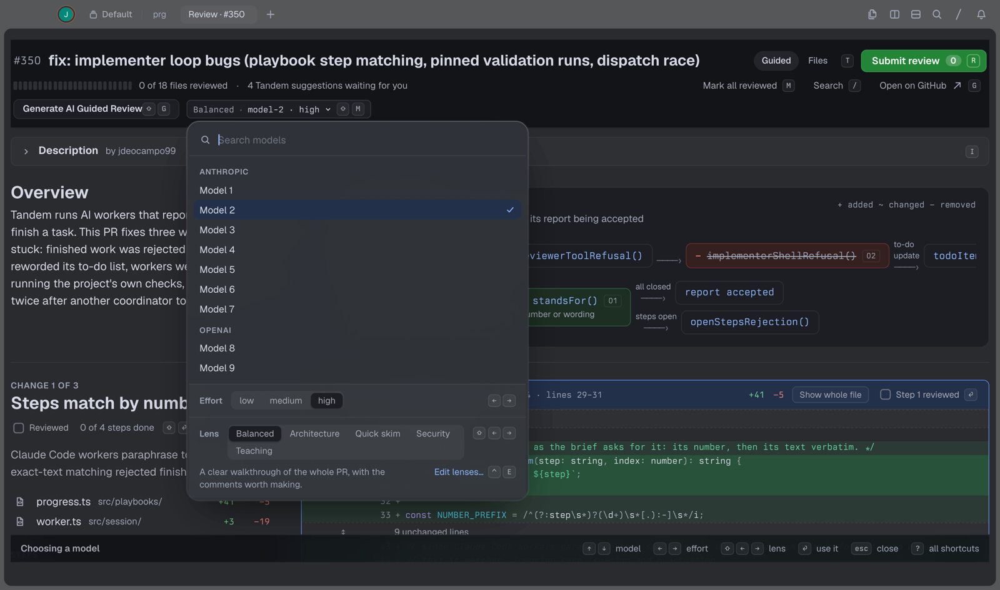
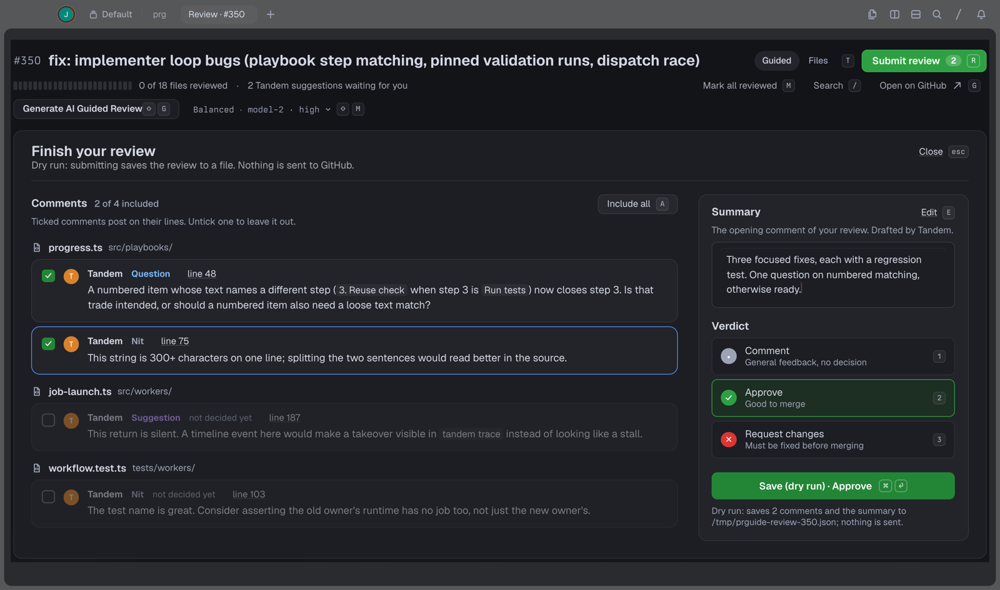

# PR Guide

> [!NOTE]
> PR Guide is in active development. Features, keys and the saved guide format may change between
> versions.

**A Tern plugin for tracking pull requests across repositories, reading their diffs and posting
reviews.**

With a dozen PRs open across several repositories, CI is on one page, review comments on another
and the agent fix in a separate conversation. PR Guide puts all of it in Tern.

## What it does

- **All your PRs on one board.** PRs from every repository are sorted into Needs fixes, In review
  and Ready to merge. Each card says why it's there.
- **Teammates' PRs in one place.** See what waits for your review, what waits on the author and
  what's approved.
- **No trips to the browser.** Read the diff, comment on lines and submit the GitHub review in the
  terminal.
- **Two ways to read a PR.** A file view like GitHub's, or a guided walkthrough written by your
  agent, inspired by Linear Diffs.
- **Fixes done for you.** An agent resolves conflicts and addresses bot reviews in an isolated
  worktree. You review its commit before anything is pushed. Flaky checks are flagged.
- **Merging the way each repository does.** PR Guide detects a merge queue, Aviator or a `/merge`
  comment, and can merge a PR as soon as it's ready.
- **Keyboard first.** Keyboard support is fully enabled to navigate your PRs quickly. See
  [docs/keys.md](docs/keys.md).



## Install

PR Guide needs Tern and the [GitHub CLI](https://cli.github.com) signed in to GitHub.
[OMP](https://omp.sh) is optional. It runs guided reviews and agent fixes. Everything else works
without it.

```sh
gh auth login
tern plugin install github.com/jubbydev/tern-pr-guide
```

Press `⌥⌘R` in Tern, or choose **PR hub** from the command palette. Press `?` on any page for its
keys.

To look around before using real PRs:

- **New PR hub sample block** opens a board of recorded sample data.
- **New PR Guide sample block** opens a sample PR. Its review is a dry run.

To work on the plugin, clone it and run `tern plugin link /path/to/tern-pr-guide`. **New PR Guide
worst-case sample block** opens a PR built to stress the page, with long titles, 60 files and a
12-step change. Its **…, no guide** variant adds long model names and every effort level.

## Your pull requests

The **Your pull requests** tab sorts every PR you opened into three columns:

- **Needs fixes:** requested changes, unresolved comments, failing checks, a conflict or a failed
  merge-queue run. Each reason is a chip on the card.
- **In review:** waiting on a reviewer, on checks or on Tandem.
- **Ready to merge:** approved, passing and free of conflicts. A queued merge stays here while its checks run again.

The **Next up** bar shows the most urgent PR. Drafts and PRs with no activity for 7 days move to a
hidden **Inactive** group, where you can select stale PRs and close them together. To close one PR,
select its card, press `X`, then `⌘⏎`.

A merged PR leaves the board. The folded **Recently merged** list (`R`) keeps your 20 latest merges
from the past 7 days.

### Checks

Each card shows its checks as one mark: failing in red, unfinished as "3 pending" in amber,
otherwise the passed count in green. Click it or press `V` to list the PR's reviewers, then every
check on the latest commit, grouped Failing, Running, Queued and Passed, with how long each ran.
`⏎` opens a check's page. Running checks update every 30 seconds while the list is open.



### Alerts

A PR that lands in Needs fixes gets a red outline, and the status-line segment flashes. The segment
shows how many PRs need fixes or review. Failed merges, failing checks and feedback from a person
also show a toast. Conflicts don't, because they arrive in bursts.

### Filters

Open **Filter** (`F`) to choose repositories or add title conditions: contains, does not contain,
starts with, does not start with. Matching ignores case. Conditions combine, and saved filters also
narrow Next up. Filters are remembered for each GitHub account. Search is only temporary.

- `⏎` on a rule edits it. `Space` switches it off without losing its value.
- **Filter · N** counts enabled rules. **Clear filters** removes them.
- In the editor, `Tab` switches between text and options, `⏎` applies and `Esc` cancels.

**Ignoring checks.** Choose **Ignore a check…**, pick the repository and type the exact check name.
A PR whose only failure is an ignored check, such as an approval check, stays in **In review**
instead of **Needs fixes**. The check stays visible and failing, and still blocks **Ready to
merge**.

### Merging

Each repository has one merge setting: squash, merge commit, rebase, merge queue, a comment command
such as `/aviator merge`, or a label. PR Guide reads it from the repository's config, or learns it
from recent merges and asks you once to confirm. Merge one PR, merge several selected PRs together,
or set an In review PR to merge as soon as it's ready.

### Auto-land

Press `⇧Q` on one of your PRs to keep it moving until it merges. Auto-land asks for the merge with
the repository's setting. If checks fail or the queue drops the PR, it rebases the branch (or
pushes an empty commit when it is up to date) and asks again. It needs a confirmed merge queue,
comment command or label setting, and runs only while the hub is open.

- The card shows "Auto-land · try 2 of 5".
- It stops when the tries run out, on a merge conflict, on new commits from someone else, when
  changes are requested or when an approval goes away. The card moves to Needs fixes as
  **Auto-land stopped**, with the reason.
- Your own pushes keep it on. Cancel merge, removing the merge label or merging with `M` turns it
  off.
- In Settings (`⇧S`), `-` and `+` set the number of tries (default 5). `⇧D` edits the dequeue
  label a merge bot adds when it drops a PR (default `blocked`).



## Review teammates' PRs

The **Review requests** tab sorts the PRs others asked you to review:

- **To review:** requests that name you, including a request to review again after you approved,
  PRs whose review from you was dismissed, and PRs you added by pasting a link.
- **Waiting on author:** you requested changes or left comments.

Four folded lists sit below the board:

- **Inactive:** requests that name you with no activity for 7 days. PRs added by link stay in To
  review.
- **Team requests:** PRs that ask a team you're on, such as a CODEOWNERS team, and not you by name.
  Paste a link in the add field to move one to To review.
- **Approved:** PRs you approved. New commits don't move one back. Its card notes "New commits
  since you approved" until the author asks you again.
- **Recently opened:** any PR you opened before, even after it closes.

Team requests and approved PRs don't count toward the tab's number or Next up.

To have guides ready before you open a PR, turn on **Prepare AI guides in the background** in
Settings (`⇧S`, then `⇧G`). After each refresh, OMP explains each request whose guide is missing or
out of date, one at a time. It never drafts review comments. The setting is off by default, since
each guide is an OMP run.

## Open a PR in the hub

`⏎` on a card or a recent row opens its page in place of the board. `Esc`, with nothing open on the
page, returns to the board with the card still selected.

- Tabs in the header: **Fixes** (Needs fixes PRs, opened first), **Guided** (when the PR has a
  guide) and **Files**. `t` cycles them.
- The status row shows the PR's reviews ("Approved · 2", "Changes requested" or "Review required")
  and its checks. Click either, or press `v`, to list the reviewers and the checks.
- The hub keeps the last three PRs you opened, with their drafts, marks and any guide being
  written. A page with an unsent comment or an agent run in progress is never dropped.

**Actions menu.** `⇧P` (or the **Actions** button at the right of the status row) lists what to do
with the PR, in groups: Merge, Merge when ready or Cancel merge, and Update branch; Re-request
review and Mark all reviewed; Copy link and Open on GitHub; Close pull request. The rules match the
card on the board. Outside the hub the menu has Mark all reviewed and Open on GitHub only. `j` `k`
move, `⏎` or a row's own key chooses, `Esc` closes. `u` updates the branch without opening the menu,
when the PR offers it. Merge and Close ask first: `⌘⏎` confirms and `Esc` cancels. The page stays
open with a notice of what happened.

## Fix what's blocking

Open a Needs fixes card to go straight to the problems: requested changes, comments, failing checks
and conflicts, each next to its code. Reply to a thread, resolve it, read a check's log or re-run
failed checks from the same page.



**Check logs.** A failing check with no annotations shows its log, cut to the lines around the
error, with the changed lines it names.

- GitHub Actions works through `gh`.
- Buildkite works through the [`bk` CLI](https://github.com/buildkite/cli), signed in with
  `bk auth login`. PR Guide asks for the organization in the check's link.
- Other CI shows the check's summary. `⇧L` opens its page.

**Re-run failed checks.** `⇧R` re-runs failed GitHub Actions runs (`gh run rerun --failed`) and
failed Buildkite jobs (`bk job retry`). A check from another CI is named in the error.

**Run checks on a new commit.** For a check that can't be re-run, `U` gives the branch a new head.

- When the branch is behind its base, **Update branch** merges the base in. The panel says how many
  commits behind it is.
- When it is up to date, **Push empty commit** adds a commit that changes nothing, through GitHub's
  API. It asks first (`⌘⏎` confirms).
- Neither shows when the branch conflicts with its base.

**Flaky checks.** A failure that also happens on main, for example "failed 3 of the last 20 runs on
main", is marked **Likely flaky**, so a re-run is the obvious next step.

**Feedback summaries.** `⇧A` writes a one-line summary of what reviewers asked for, such as "Reply
to @maria-k", then one line for each commenter.

### Agent fixes

Your OMP agent resolves a conflict or addresses a bot review in an isolated worktree, never in your
checkout.

- **Progress.** The card shows the current step, an estimated progress bar and a clock. A ready fix
  survives a plugin reload.
- **Fewer tokens.** The base branch is merged in first. Lockfiles are regenerated, and only the
  remaining conflicts go to the agent.
- **Review before push.** The fix opens on a review page that labels every line as from the base
  branch, your branch or the agent. Push unlocks once every conflict is marked reviewed.
- **Agent chat.** After a conflict fix ends, `⇧O` resumes the agent's conversation in an `omp` pane
  in the fix worktree. Edits there become a new commit, the card reads **Review again**, and Push
  stays locked until you review it. Bot-comment fixes keep no conversation. Conversations older
  than 30 days are removed.
- **Sandboxed bot fixes.** When the agent addresses a bot review, it can write only inside its
  worktree.
- **Tandem.** A PR that Tandem watches goes back to its Tandem coordinator instead of a new agent.

## Read a PR

Open any card to see the whole PR in Tern. `t` switches between the two views, and comments,
reviewed marks and the summary carry over.

**Files** works like GitHub's PR page: the description, the changed files as a folder tree, search
across the changed code, and comments on any line.

- The diff comes from local git, so GitHub's diff size limit doesn't apply.
- Tests and generated files come last, under folding rows.
- Code is colored by language, with changed words marked, for JavaScript and TypeScript, Python,
  Go, Rust, Ruby, Java, Kotlin, Swift, C and C++, C#, shell, Lua and Luau, CSS and SCSS, JSON,
  YAML, TOML and SQL. Other files show plain text.



**Guided** is an AI walkthrough inspired by Linear Diffs. You see the shape of the change first,
then go through it in small steps:

- A plain-language overview and, for some PRs, a before-and-after diagram with a "Check" line
  naming the consequence to confirm.
- The PR split into a few changes, and each change into steps pinned to their lines.
- Code blocks that start at the enclosing function, method or class, so a step reads in context.
- Suggested review comments next to the code they're about.
- Moved code drawn in neutral gray, labeled "Moved from src/a.ts:12" or "Moved to line 40".
- Supporting changes folded away: files no step visits, then "Tests" and "Generated" groups (files
  marked `linguist-generated`). Lockfiles are left out of the PR altogether.
- Guides saved in the repository, so a reopened PR loads its guide right away in every worktree.





**Generate AI guide** (`⇧G`) writes the walkthrough in one OMP request from the PR's description
and diff. Generated, vendored and minified files and test snapshots show as one line each, and
whitespace-only changes are counted instead of shown, except in Python and YAML.

**Generate LLM review** (`⇧R`) is a separate OMP run that drafts comments on problems and questions
and a review summary. It works with or without a guide. A summary you already edited is kept.

## Choose models and a review lens

Guides and drafted comments need OMP. Click **Settings** at the right of the status row, or press
`⇧M`. The menu has three slots, and `Tab` steps through them:

- **Explanation:** the model and effort that write the walkthrough. A fast model at low effort is
  enough.
- **Review:** the model and effort that draft comments. A strong model works best, and higher
  effort finds more.
- **Lens:** what the review comments pay attention to.

Until you choose an explanation model, it uses OMP's `smol` model, else OMP's default model, else
the review model. The hub's Settings (`⇧S`) show the same menu. Agent fixes and feedback summaries
use the review model.

`⇧L` opens the menu on the Lens slot. A lens steers only the review comments. PR Guide ships four:

- **Balanced:** the comments worth making on the whole PR.
- **Security:** the change from an attacker's point of view.
- **Architecture:** boundaries, dependencies and long-term cost.
- **Quick skim:** only the comments that matter.



To write your own, choose **Edit lenses…** to open your lenses folder and add a Markdown file for
each lens:

```markdown
# Performance

Slow paths and wasted work.

Check for repeated work in loops, unnecessary copying, blocking calls on hot paths and queries that
could be batched. Comment only when the cost will matter in practice.
```

A custom lens with the same name as a built-in one replaces it.

## Post the review

The agent's comments are suggestions until you add them to your review. Open the review panel
(`r`), pick Comment, Approve or Request changes, edit the summary, and submit everything as one
GitHub review.



- **Two presses to submit.** The first press shows what will be posted and where. Any other key
  cancels.
- **No stale reviews.** If the PR has new commits since you started reading, submission stops until
  you refresh.
- **Dry runs.** The sample block and any guide opened with `post=false` save the review to a JSON
  file under `/tmp` and never write to GitHub.

## Keys

Press `?` on any page for its shortcuts. The full list is in [docs/keys.md](docs/keys.md).

## For tool authors

Open a PR from another tool with the `prguide.guide` block:

```lua
cx:new_block("prguide.guide", {"pr=123", "repo=/path/to/your/clone"}, "tab")
```

| Argument | Meaning |
|---|---|
| `repo=` | A path inside the repository clone |
| `pr=` | A PR number or URL |
| `guide=` | A saved guide JSON file; see [GUIDE.md](GUIDE.md) |
| `post=false` | Save the review under `/tmp` |
| `generate=true` | Generate a guide when the PR opens |

PR Guide fetches the PR into `refs/prguide/<number>/*` and doesn't touch your branches or working
tree. Without a local clone, it keeps a light copy under Tern's plugin-data folder. Saved guides
live at `.git/prguide/<number>.json`, in the format documented in [GUIDE.md](GUIDE.md).

While open, the hub uses about 130 GitHub GraphQL points an hour, against GitHub's limit of 5,000.
It loads from its cache, checks for changes with conditional requests and batches its queries.
